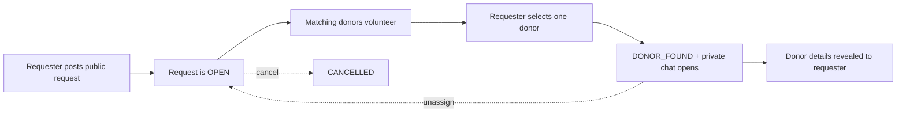
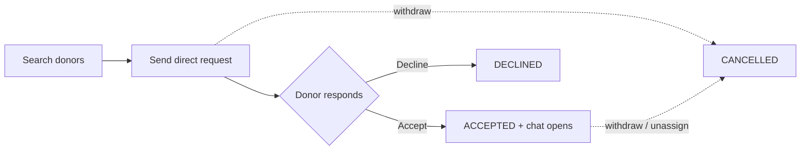
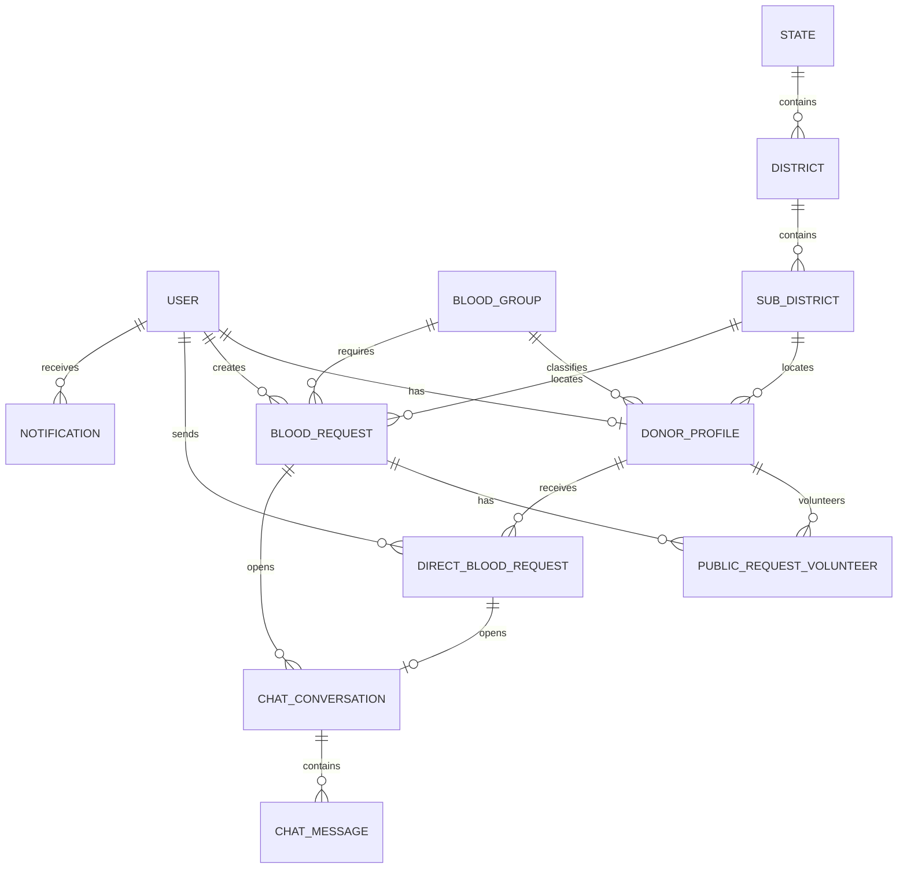

<div align="center">

# 🩸 BloodLink — Blood Donation & Emergency Donor Finder

**Find donors. Save lives.**

A full-stack web platform that connects people who urgently need blood with willing, registered donors, with location search, public requests, direct requests, in-app chat and real-time notifications.


</div>

---

## 📑 Table of Contents

- [✨ Overview](#-overview)
- [🚀 Key Features](#-key-features)
- [🧰 Tech Stack](#-tech-stack)
- [🏗️ Architecture](#️-architecture)
- [🔄 How It Works](#-how-it-works)
- [📂 Project Structure](#-project-structure)
- [⚙️ Getting Started](#️-getting-started)
- [🔐 Environment Variables](#-environment-variables)
- [🌐 API Reference](#-api-reference)
- [🗃️ Data Model](#️-data-model)
- [🛡️ Security & Privacy](#️-security--privacy)
- [🗺️ Roadmap](#️-roadmap)
- [🤝 Contributing](#-contributing)
- [👤 Author](#-author)

---

## ✨ Overview

In an emergency there is rarely time to look for a donor. **BloodLink** gives patients and families two ways to reach help quickly:

1. 📢 **Public requests**: post a request that any matching, available donor can volunteer for.
2. 🎯 **Direct requests**: search for donors by blood group and location, then send a request to one specific donor.

Once a donor is selected (or accepts), both sides get a **private chat**, and every important event triggers an **in-app notification**.

> 📍 Location search is built on India's **LGD (Local Government Directory)** hierarchy: **State / UT → District → Sub-district (Taluk)**.

---

## 🚀 Key Features

### 👤 Accounts & Donor Profiles
- 🔑 Token-based registration, login and session handling
- 🧑‍⚕️ Create, edit and delete a donor profile (blood group, DOB, gender, weight, location, last donation date)
- 🟢 Toggle availability (`AVAILABLE` / `UNAVAILABLE`)
- ✅ Server-side eligibility validation:
  - Age **18–65**
  - Weight **≥ 45 kg**
  - Valid **10-digit Indian mobile number** (`+91` prefix is normalised)
  - Last donation date cannot be in the future

### 🔍 Donor Search
- Filter available donors by **blood group**, **state**, **district** and **sub-district**
- Cascading location dropdowns loaded from the API
- Your own profile is excluded from results
- 🙈 Donor **phone numbers are never exposed** in search results

### 📢 Public Blood Requests
- Anyone can browse open requests (auto-scrolling feed on the home page, refreshed every 30 s)
- Logged-in users can post a request with blood group, units, hospital, urgency, required-by time and location
- Matching, available donors can **volunteer**; the requester reviews volunteers and **selects one**
- Donor contact details are revealed **only to the requester**, and only after selection
- Requester can cancel at any time; volunteers are notified automatically

### 🎯 Direct Requests
- Send a private request to a specific donor from the search results
- Donor can **accept** or **decline**; requester can **withdraw**
- Blood group is taken from the donor's profile, so it always matches

### 💬 Chat & 🔔 Notifications
- Private 1-to-1 conversations between requester and selected donor
- Unread tracking, polling-based live updates, and **unassign**, which closes the chat but keeps history
- Persistent notifications for requests, volunteers, selection, cancellations and messages
- Global toast notifications + unread indicator in the header

### 🧭 Informational Home Page
- Hero, service cards, "How donation works" and "Why donate" sections
- Interactive **blood-group compatibility chart** (ABO + Rh)
- Eligibility criteria for donating in India

---

## 🧰 Tech Stack

| Layer | Technology |
| --- | --- |
| 🖥️ **Frontend** | React 19, React Router 7, Vite 8, Tailwind CSS 4 |
| ⚙️ **Backend** | Python, Django 6.1, Django REST Framework 3.18 |
| 🔐 **Auth** | DRF Token Authentication |
| 🗄️ **Database** | PostgreSQL (via `psycopg` 3) |
| 🌍 **CORS** | `django-cors-headers` (configured for the Vite dev server) |
| 📊 **Data** | LGD location dataset + blood-group CSV, loaded by management commands |
| 🧹 **Tooling** | ESLint 10, `python-dotenv` |

---

## 🏗️ Architecture

```
┌──────────────────────┐        REST / JSON         ┌──────────────────────────┐
│  React + Vite SPA    │  ───────────────────────▶  │  Django + DRF API        │
│  Tailwind CSS        │  ◀───────────────────────  │  Token authentication    │
│  localStorage token  │     Authorization: Token   │  7 domain apps           │
└──────────────────────┘                            └────────────┬─────────────┘
                                                                 │
                                                       ┌─────────▼─────────┐
                                                       │    PostgreSQL     │
                                                       └───────────────────┘
```

The backend is split into focused Django apps:

| App | Responsibility |
| --- | --- |
| `accounts` | Custom user model, register / login / current-user |
| `donors` | Donor profiles and donor search |
| `blood_groups` | The 8 ABO/Rh blood groups (reference data) |
| `locations` | State → District → Sub-district hierarchy (reference data) |
| `blood_requests` | Public requests, volunteers, direct requests |
| `chats` | Conversations and messages |
| `notifications` | Persistent notifications and helpers |

---

## 🔄 How It Works

### Public request flow



### Direct request flow



### Business rules enforced by the server
- 🚫 A user can have **only one active** request (public or direct) at a time
- 🚫 You cannot volunteer for, or send a direct request to, **yourself**
- 🩸 Donor and request **blood groups must match**
- 🟢 Only **available** donors can volunteer or accept
- 🔒 A donor can have only **one accepted** direct request at a time (DB-level unique constraint)
- 🔁 State changes use `select_for_update()` inside transactions to prevent race conditions

---

## 📂 Project Structure

```
blood-donation-finder/
├── backend/
│   ├── config/                 # Django settings, root URLs, ASGI/WSGI
│   ├── accounts/               # User model, auth endpoints
│   ├── donors/                 # Donor profile + search
│   ├── blood_groups/           # Blood group model + import command
│   ├── locations/              # State/District/SubDistrict + import command
│   ├── blood_requests/         # Public & direct request logic
│   ├── chats/                  # Conversations & messages
│   ├── notifications/          # Notification model, views, helper
│   ├── data/
│   │   ├── blood_groups/blood_groups.csv
│   │   └── locations/india_locations.csv.zip
│   ├── manage.py
│   └── requirements.txt
│
├── frontend/
│   ├── public/
│   ├── src/
│   │   ├── pages/              # Home, Login, Register, FindDonors, Inbox, ...
│   │   ├── components/
│   │   │   ├── chat/           # chatApi + global notification toasts
│   │   │   ├── donor/          # Shared donor-profile helpers
│   │   │   ├── notifications/  # notificationApi
│   │   │   └── HomePublicRequests.jsx
│   │   ├── App.jsx             # Routes + protected/guest guards
│   │   └── main.jsx
│   ├── package.json
│   └── vite.config.js
│
└── README.md
```

---

## ⚙️ Getting Started

### ✅ Prerequisites

- 🐍 Python **3.12+**
- 🟢 Node.js **20+** and npm
- 🐘 PostgreSQL running locally

### 1️⃣ Clone the repository

```bash
git clone https://github.com/rohithkumar1104/blood-donation-finder.git
cd blood-donation-finder
```

### 2️⃣ Set up the backend

```bash
cd backend

# Create and activate a virtual environment
python -m venv .venv
source .venv/bin/activate        # Windows: .venv\Scripts\activate

# Install dependencies
pip install -r requirements.txt
```

Create a PostgreSQL database, then add a `.env` file inside `backend/` (see [Environment Variables](#-environment-variables)).

```bash
# Apply migrations
python manage.py migrate

# Load reference data
python manage.py import_blood_groups
python manage.py import_locations

# (Optional) create an admin user
python manage.py createsuperuser

# Start the API on http://127.0.0.1:8000
python manage.py runserver
```

### 3️⃣ Set up the frontend

```bash
cd frontend
npm install
npm run dev
```

The app runs at **http://localhost:5173** 🎉

### 📜 Useful scripts

| Command | Where | Purpose |
| --- | --- | --- |
| `python manage.py runserver` | `backend/` | Start the API |
| `python manage.py import_blood_groups` | `backend/` | Load the 8 blood groups |
| `python manage.py import_locations` | `backend/` | Load states, districts, sub-districts |
| `npm run dev` | `frontend/` | Start the dev server |
| `npm run build` | `frontend/` | Production build |
| `npm run lint` | `frontend/` | Run ESLint |
| `npm run preview` | `frontend/` | Preview the production build |

---

## 🔐 Environment Variables

Create `backend/.env`:

```env
DJANGO_SECRET_KEY=replace-with-a-long-random-string

DB_NAME=blood_donation
DB_USER=postgres
DB_PASSWORD=your-password
DB_HOST=localhost
DB_PORT=5432
```

> ⚠️ `.env` is git-ignored. **Never commit secrets.**

> 📝 The frontend currently calls the API at `http://127.0.0.1:8000/api`, and CORS allows `http://localhost:5173` and `http://127.0.0.1:5173`.

---

## 🌐 API Reference

Base URL: `http://127.0.0.1:8000/api`
Authenticated endpoints expect the header: `Authorization: Token <your-token>`

### 🔑 Auth: `/auth/`

| Method | Endpoint | Auth | Description |
| --- | --- | :---: | --- |
| `POST` | `/auth/register/` | ❌ | Create an account and receive a token |
| `POST` | `/auth/login/` | ❌ | Log in and receive a token |
| `GET` | `/auth/me/` | ✅ | Get the current user |

### 🧑‍⚕️ Donors: `/donors/`

| Method | Endpoint | Auth | Description |
| --- | --- | :---: | --- |
| `GET` | `/donors/profile/` | ✅ | View your donor profile |
| `POST` | `/donors/profile/` | ✅ | Create your donor profile |
| `PUT` / `PATCH` | `/donors/profile/` | ✅ | Update your donor profile |
| `DELETE` | `/donors/profile/` | ✅ | Delete your donor profile |
| `GET` | `/donors/search/` | ❌ | Search available donors. Query: `blood_group`, `state`, `district`, `sub_district` |

### 🩸 Reference data

| Method | Endpoint | Description |
| --- | --- | --- |
| `GET` | `/blood-groups/` | List all blood groups |
| `GET` | `/locations/states/` | List states / UTs |
| `GET` | `/locations/districts/?state=<id>` | Districts of a state |
| `GET` | `/locations/sub-districts/?district=<id>` | Sub-districts of a district |

### 📢 Public requests: `/blood-requests/`

| Method | Endpoint | Auth | Description |
| --- | --- | :---: | --- |
| `GET` | `/blood-requests/` | ❌ | List open public requests |
| `POST` | `/blood-requests/` | ✅ | Create a public request |
| `GET` | `/blood-requests/my/` | ✅ | Requests you created |
| `GET` | `/blood-requests/my-volunteering/` | ✅ | Requests you volunteered for |
| `GET` | `/blood-requests/<id>/` | ✅ | Request detail |
| `POST` | `/blood-requests/<id>/volunteer/` | ✅ | Volunteer as a donor |
| `GET` | `/blood-requests/<id>/volunteers/` | ✅ | List volunteers (requester only) |
| `POST` | `/blood-requests/<id>/select/<volunteer_id>/` | ✅ | Select a donor |
| `GET` | `/blood-requests/<id>/selected-donor-contact/` | ✅ | Selected donor's contact (requester only) |
| `POST` | `/blood-requests/<id>/cancel/` | ✅ | Cancel your request |

### 🎯 Direct requests: `/blood-requests/direct/`

| Method | Endpoint | Auth | Description |
| --- | --- | :---: | --- |
| `POST` | `/blood-requests/direct/` | ✅ | Send a request to a donor |
| `GET` | `/blood-requests/direct/sent/` | ✅ | Requests you sent |
| `GET` | `/blood-requests/direct/received/` | ✅ | Requests you received |
| `POST` | `/blood-requests/direct/<id>/respond/` | ✅ | Donor responds with `{"action": "accept" \| "decline"}` |
| `POST` | `/blood-requests/direct/<id>/withdraw/` | ✅ | Requester withdraws |

### 💬 Chats: `/chats/`

| Method | Endpoint | Auth | Description |
| --- | --- | :---: | --- |
| `GET` | `/chats/conversations/` | ✅ | Your open conversations |
| `GET` | `/chats/incoming-messages/` | ✅ | Incoming messages (`after_id` supported) |
| `POST` | `/chats/direct/<request_id>/` | ✅ | Open chat for an accepted direct request |
| `POST` | `/chats/public/<request_id>/` | ✅ | Open chat for a selected public donor |
| `GET` / `POST` | `/chats/conversations/<id>/messages/` | ✅ | Read / send messages |
| `POST` | `/chats/conversations/<id>/unassign/` | ✅ | Unassign and close the chat |

### 🔔 Notifications: `/notifications/`

| Method | Endpoint | Auth | Description |
| --- | --- | :---: | --- |
| `GET` | `/notifications/` | ✅ | List notifications + unread count |
| `POST` | `/notifications/<id>/read/` | ✅ | Mark one as read |
| `POST` | `/notifications/read-all/` | ✅ | Mark all as read |

---

## 🗃️ Data Model



**Request statuses**

| Model | Statuses |
| --- | --- |
| `BloodRequest` | `OPEN` → `DONOR_FOUND` → `COMPLETED` / `CANCELLED` |
| `DirectBloodRequest` | `PENDING` → `ACCEPTED` / `DECLINED` → `COMPLETED` / `CANCELLED` |
| `PublicRequestVolunteer` | `ACTIVE` / `WITHDRAWN` |
| Urgency | `NORMAL`, `URGENT`, `CRITICAL` |

---

## 🛡️ Security & Privacy

- 🔒 Token authentication, and every non-public endpoint requires `IsAuthenticated`
- 🙈 Phone numbers are excluded from donor search and public request cards
- 👀 Selected-donor contact details are visible **only to the requester**
- 🧑‍🤝‍🧑 Chats are restricted to the two participants, and closed chats cannot be read or written to
- 🔁 Row-level locking (`select_for_update`) and DB constraints protect against double-accepts and race conditions
- 🔑 Passwords are validated with Django's built-in validators and stored hashed
- 🌍 CORS restricted to the local frontend origins

> ⚠️ **Before deploying to production:** set `DEBUG = False`, configure `ALLOWED_HOSTS`, use a strong `DJANGO_SECRET_KEY`, serve over HTTPS, and move the API base URL in the frontend into an environment variable.

---

## 🗺️ Roadmap

- [ ] 🔌 WebSocket-based chat and notifications (currently polling)
- [ ] 📱 SMS / email alerts for critical requests
- [ ] 📍 Distance-based donor matching
- [ ] ⏳ Donor cool-down tracking (auto-unavailable after donation)
- [ ] ✅ Mark requests as `COMPLETED` from the UI
- [ ] 🧪 Expanded automated test coverage
- [ ] 🐳 Docker setup and CI/CD pipeline
- [ ] 🚀 Production deployment guide

---

## 🤝 Contributing

Contributions, issues and feature requests are welcome!

1. 🍴 Fork the repository
2. 🌿 Create a feature branch: `git checkout -b feature/amazing-feature`
3. 💾 Commit your changes: `git commit -m "Add amazing feature"`
4. 📤 Push to the branch: `git push origin feature/amazing-feature`
5. 🔁 Open a Pull Request

---

## ⚕️ Disclaimer

BloodLink is a community connection tool and is **not a substitute for professional medical advice**. Donor eligibility is always confirmed by a doctor at the blood bank. In an emergency, contact your nearest hospital.

---

## 👤 Author

🔗 GitHub: [@rohithkumar1104](https://github.com/rohithkumar1104)

<div align="center">

⭐ If you find this project useful, please give it a star! ⭐

**Donate blood. Save lives.** ❤️

</div>
